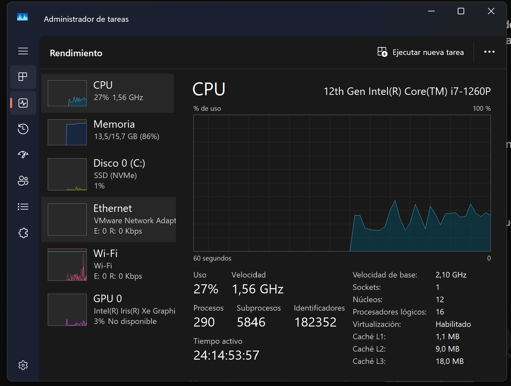
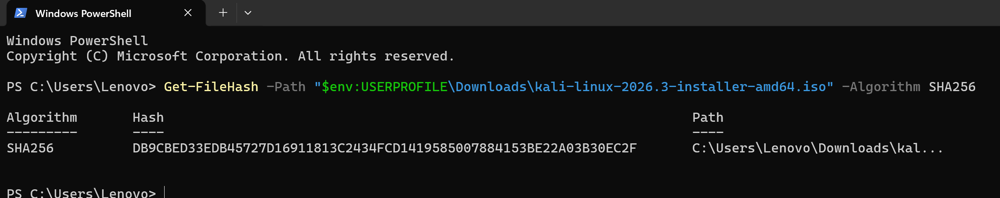
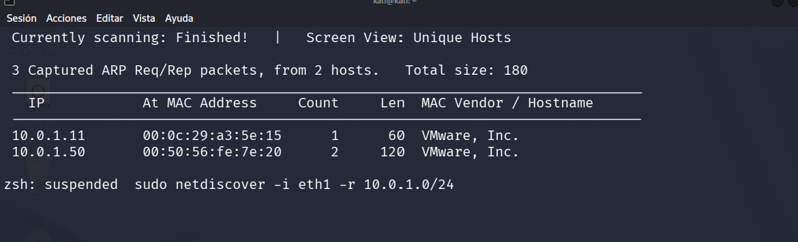
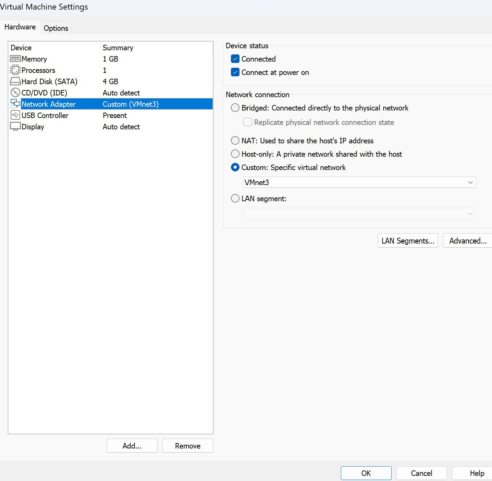
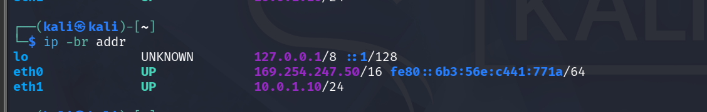

# UD01_LAB00_DAS

## Misión 0

**Autor:** Daniel Adriaque Soler

**Curso:** Curso de Especialización en Ciberseguridad

### Carpeta de evidencias

1. ¡Mis súper evidencias de los Hitos! (H1 al H6)

#### H1 · ¡

**Lo que hice:** Mirar que mi CPU estaba en modo virtualización activada.

**Evidencia:**

#### H2 ·

**Lo que hice:** Descargar Kali, comprobar su código (hash SHA256)

**Evidencia:**

#### H3 ·

**Lo que hice:** Montar un servidor DHCP para que la red privada reparta IPs

**Evidencia:**

#### H4 ·

**Lo que hice:** Importar la máquina  y ponerle un único adaptador de red

**Evidencia:**

#### H5 ·

**Lo que hice:** Usar herramientas de espía (netdiscover y pings) para encontrar la IP de la víctima (10.0.1.50).

**Evidencia:**

### Preguntas

**¿Por qué DC-1 no debe tener adaptador NAT ni puente?**

Porque si no, la máquina vulnerable se nos escapa a internet. Si tuviera conexión con el exterior, podría infectar a otros ordenadores reales

**¿Para qué sirve el servidor DHCP que creaste en H3?**

Como las redes privadas no reparten (IPs) solas, el DHCP automáticamente para darle una IP a cada maquina y se puedan comumicar

**¿Qué hacen netdiscover y ping, y qué información te dio cada uno?**

netdiscover: Es como un radar escanea la red local y te chiva las direcciones IP y las MAC de todos los equipos conectados

ping: Es para ssaber si podemos manterter un conversacion con el equipo que le han asignado el Dhcp la ip

**¿Qué precauciones adicionales de seguridad se deben tomar al configurar un entorno de prácticas con múltiples máquinas vulnerables?**

Asegurarnos de apagar el Wi-Fi o desconectar el cable físico y comporbar que la red esta aislada

**¿Qué ventajas aporta el uso de instantáneas (snapshots) antes de realizar una prueba de penetración en un laboratorio?**

Sirve porsi hacemos un error irreparable poder volver a la maquina como estaba cuando hiciste ese snapsp

### Que le he preguntado a la IA

**El gran problema (Error encontrado):** Al usar VMware en lugar de VirtualBox los comandos de red y los menús de configuración venían cambiados y no sabía muy bien dónde tocar para crear el segmento privado y enganchar el adaptador secundario eth1.

**Lo que le pregunté a la IA:**

Estoy haciendo todo desde VmWare y como hago la activadad

¿cómo configuro la red personalizada en modo Custom (VMnet3) y cómo reviso mi interfaz secundaria eth1

**Cómo lo solucionamos**

La IA me explicó paso a paso cómo cambiar el adaptador a modo Custom (VMnet3) en las opciones de VMware, cómo verificar con el comando ip -br addr